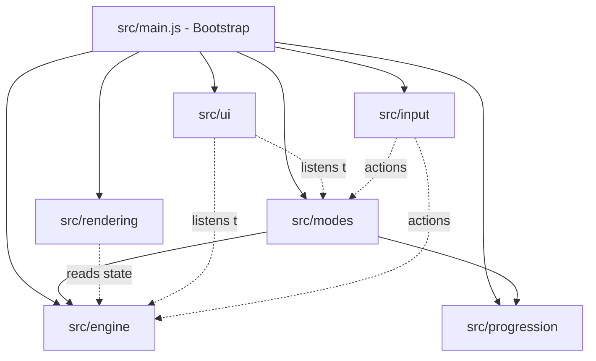

# SPINFORGE 🌀

A high-performance, modular browser-based spinning-top battle game built on native Web Standards and ES Modules.

---

## 🏛️ System Architecture

SPINFORGE is architected around a strict decoupled unidirectional data flow. Simulation physics, rendering passes, input capture, and UI overlays are isolated into dedicated subsystems with zero circular dependencies.



---

## 📁 Directory Structure

```text
spinforge/
├── index.html                  # HTML5 shell & canvas container
├── package.json                # Project manifest & test/run scripts
├── server.js                   # Zero-dependency local ES module dev server
├── README.md                   # Project documentation & setup instructions
├── styles/
│   ├── main.css                # Base layouts, dark sci-fi theme tokens & canvas styling
│   └── ui.css                  # HUD tachometer gauges, rip-cord meter, modals & forge
├── src/
│   ├── main.js                 # Application entry point & subsystem coordinator
│   ├── engine/                 # Physics, kinematics, arena boundaries & game loop
│   │   ├── Vector2.js          # 2D vector mathematics primitive
│   │   ├── Arena.js            # Bowl stadium geometry, slope gravity & knockout pockets
│   │   ├── SpinningTop.js      # Battle top entity, RPM decay, wobble & burst resistance
│   │   ├── PhysicsWorld.js     # Elastic collisions, spin clashing & boundary resolution
│   │   ├── WinnerDetermination.js # Point rules, finish evaluations & simultaneous draws
│   │   ├── BattleSimulation.js # Headless & live battle coordinator
│   │   ├── GameLoop.js         # Fixed-timestep physics accumulator + render interpolation
│   │   ├── GameEngine.js       # Master engine orchestrator & event bus
│   │   ├── constants.js        # Physical constants, tick rates & finish types
│   │   └── index.js            # Engine barrel exports
│   ├── rendering/              # HTML5 Canvas 2D visualization & FX
│   │   ├── Renderer.js         # Unified master renderer interface & layer orchestrator
│   │   ├── Camera.js           # 2D camera viewport, coordinate transformations & shake
│   │   ├── CanvasRenderer.js   # High-DPI canvas & backward-compatible renderer wrapper
│   │   ├── ArenaRenderer.js    # Concave dish bowl, offscreen caching & hazard pockets
│   │   ├── TopRenderer.js      # Rotating blades, sub-frame interpolation & wobble shadows
│   │   ├── ParticleSystem.js   # Sparks, shockwaves, rim grinds, debris & combat text
│   │   └── index.js            # Rendering barrel exports
│   ├── input/                  # Hardware input handling & game controls
│   │   ├── InputManager.js     # Keyboard, pointer & touch normalizer
│   │   ├── LaunchController.js # Rip-cord launcher: sweet-spot power gauge & angle aim
│   │   └── index.js            # Input barrel exports
│   ├── modes/                  # Game rules, win conditions & match state
│   │   ├── GameMode.js         # Abstract base mode interface
│   │   ├── BattleMode.js       # 1v1 match vs AI CPU (Spin/Over/Burst finish rules)
│   │   ├── TournamentMode.js   # 8-competitor Championship Bracket (Quarterfinals -> Semifinals -> Finals)
│   │   ├── PracticeMode.js     # Sandbox free-spin laboratory with telemetry dummy
│   │   ├── SurvivalMode.js     # Multi-wave endurance gauntlet
│   │   ├── ModeManager.js      # Mode state machine & physics event router
│   │   └── index.js            # Modes barrel exports
│   ├── progression/            # Customization parts & persistent storage
│   │   ├── PartRegistry.js     # Energy Layers, Forge Discs & Performance Drivers
│   │   ├── TopBuilder.js       # Composite stat calculator & top factory
│   │   ├── ProgressionManager.js # XP, credits, unlock milestones & localStorage sync
│   │   └── index.js            # Progression barrel exports
│   └── ui/                     # Heads-up display & DOM overlays
│       ├── HUDView.js          # Tachometer RPM bars, stability gauges & event banners
│       ├── LaunchGaugeView.js  # Interactive rip-cord launcher controls & canvas touch aim
│       ├── ModalView.js        # Match results, scores & rewards dialogue
│       ├── ForgeView.js        # The Workshop: live top assembly & stat preview
│       ├── TournamentView.js   # Visual 3-tier bracket display with live competitor cards
│       ├── PauseModalView.js   # Pause menu, restart, workshop access & controls guide
│       ├── UIManager.js        # Master DOM coordinator
│       └── index.js            # UI barrel exports
└── tests/                      # Automated unit & architectural test suites
    ├── architecture.test.js    # Module integrity & export completeness
    ├── circular-dependencies.test.js # Static import graph DFS cycle detection
    ├── engine.test.js          # Vector math, arena bounds & collision physics
    ├── physics-battle.test.js  # Momentum transfer, stamina decay & battle simulation
    ├── modes.test.js           # Battle lifecycle, tournament progression & mode switching
    ├── progression.test.js     # Part catalog assembly & XP progression
    ├── rendering.test.js       # Unified renderer, camera, animations & telemetry
    ├── e2e-integration.test.js # Full end-to-end playable loop & browser persistence
    └── server.test.js          # HTML linkage, CSS tokens & MIME type delivery
```

---

## ⚡ Module Separation & Responsibilities

| Module | Primary Responsibility | Dependencies |
| :--- | :--- | :--- |
| **`src/engine/`** | 60Hz fixed-timestep physical simulation, bowl slope gravity, collision responses, angular friction, and damage. | *None (Pure Domain Logic)* |
| **`src/rendering/`** | Canvas 2D rendering pipeline, high-DPI scaling, camera shake, particles, and rotating top layers. | `src/engine/` (read-only state) |
| **`src/input/`** | Translates hardware inputs (keys, mouse, touch) into abstract actions and rip-cord launch charging. | `src/engine/Vector2.js` |
| **`src/modes/`** | Orchestrates rulesets for 1v1 Battle, Training Sandbox, and Survival modes; handles round scoring. | `src/engine/`, `src/progression/` |
| **`src/progression/`** | Defines modular parts (Layers, Discs, Drivers), calculates composite stats, and persists XP/credits. | `src/engine/` |
| **`src/ui/`** | DOM-based HUD tachometers, match banners, launch power gauge, and the Workshop part customizer. | `src/input/`, `src/progression/` |
| **`src/main.js`** | Application bootstrap: wires subsystems, connects event listeners, and starts the game loop. | All modules |

---

## 🚀 Getting Started

### Prerequisites
- Node.js (v18.0.0 or higher; developed and tested on Node.js v24)
- Any modern web browser supporting ES Modules and HTML5 Canvas

### Quick Start

1. **Clone the repository and enter directory**:
   ```bash
   cd spinforge
   ```

2. **Start the development server**:
   ```bash
   npm start
   # or: node server.js
   ```

3. **Open the game**:
   Navigate your browser to:
   ```text
   http://127.0.0.1:3000/
   ```

---

## 🎮 How to Play

- **Rip-Cord Launch**:
  - Aim your launch angle with the slider, or touch/drag anywhere directly on the arena canvas!
  - Press **SPACEBAR** or click/tap **PULL RIP-CORD** to start charging the power gauge.
  - Release in the **Sweet Spot (85% - 100%)** for maximum RPM and burst stability!
- **Game Modes**:
  - **1v1 Battle**: Face off against varied AI tops in standard first-to-3 matches.
  - **Championship Tournament**: Enter an 8-competitor single-elimination bracket (Quarterfinals -> Semifinals -> Grand Finals) to battle for the championship trophy!
  - **Training Sandbox**: Free-spin laboratory with an active test dummy to experiment with parts, mass, and launch angles.
  - **Survival Gauntlet**: Wave-based endurance challenge against increasingly ferocious challengers.
- **Match Scoring**:
  - **Spin Finish (+1 Pt)**: Out-spin the opponent's top until they stop.
  - **Over / Ring-Out Finish (+2 Pts)**: Knock the opponent into a stadium trap pocket or over the outer rim.
  - **Burst Finish (+3 Pts)**: Deliver devastating collisions to burst the opponent apart!
- **Workshop / The Forge**:
  - Click **⚡ WORKSHOP** to mix and match Energy Layers, Forge Discs, and Drivers to optimize Attack, Defense, or Stamina.
  - Custom loadouts immediately equip to your top in the active match and persist across browser reloads.
- **Pause & Tactical Controls**:
  - Press **ESC** or **P** (or click the header **⏸️** button) to pause physics while keeping visual rendering active.
  - Press **R** to instantly reset the round.

---

## 🧪 Verification & Automated Testing

SPINFORGE includes a built-in automated test suite utilizing Node.js's native test runner (`node:test` and `node:assert`):

```bash
npm test
```

### Test Coverage Highlights:
- **Module & Export Integrity**: Ensures all exported classes and constants exist without missing dependencies.
- **Zero Circular Dependencies**: Static AST/DFS graph traversal verifying zero cycles across `src/`.
- **Physics World & Vector Math**: Verifies elastic impulses, angular spin clash drain, and stadium slope forces.
- **Top Assembly & Part Registry**: Validates stat aggregation and archetype modifiers.
- **Mode Transitions**: Verifies state transitions between Battle, Training Sandbox, and Survival gauntlets.
- **Server & Entry Point Delivery**: Checks HTML script linkage, stylesheet tokens, and MIME mapping.

---

## 📜 Conventions & Coding Standards

1. **Native ES Modules**:
   - Every internal file import explicitly uses `.js` extensions for native browser compatibility:
     ```javascript
     import { GameEngine } from './engine/GameEngine.js';
     ```
2. **Naming Conventions**:
   - Classes and Components: **PascalCase** (`GameEngine.js`, `CanvasRenderer.js`, `TopBuilder.js`).
   - Constant dictionaries and registries: **UPPER_SNAKE_CASE** or **camelCase** (`constants.js`, `PartRegistry.js`).
   - Private methods and properties: Prefixed with an underscore `_` (`_resolveTopCollision`, `_buildElements`).
3. **Decoupled Architecture**:
   - The engine never queries the DOM or canvas context.
   - The renderer never mutates physics state.
   - User inputs emit high-level intents (`launch`, `reset`, `pause`) rather than directly modifying entity coordinates.

